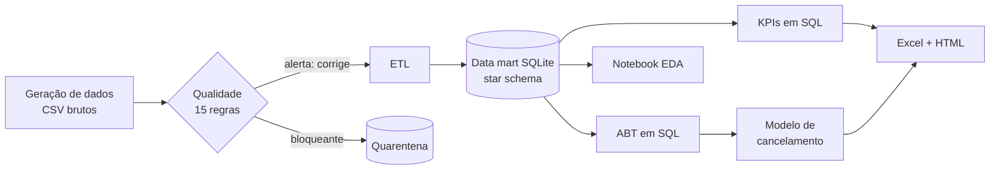
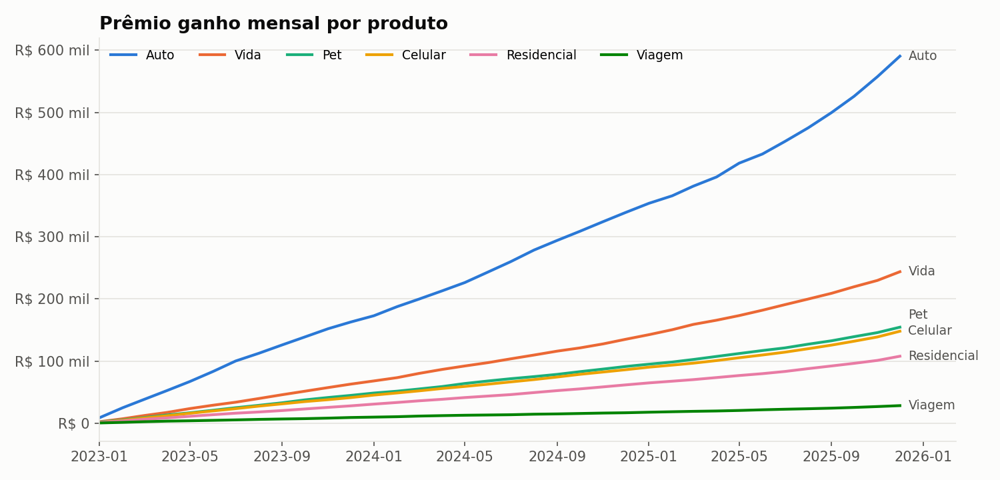
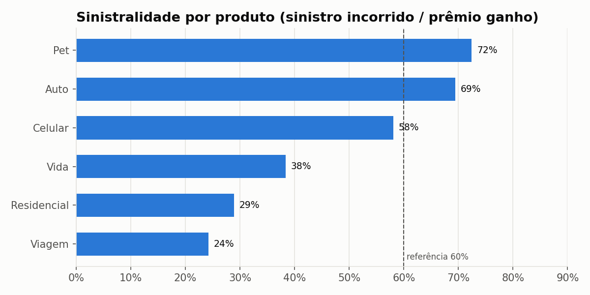
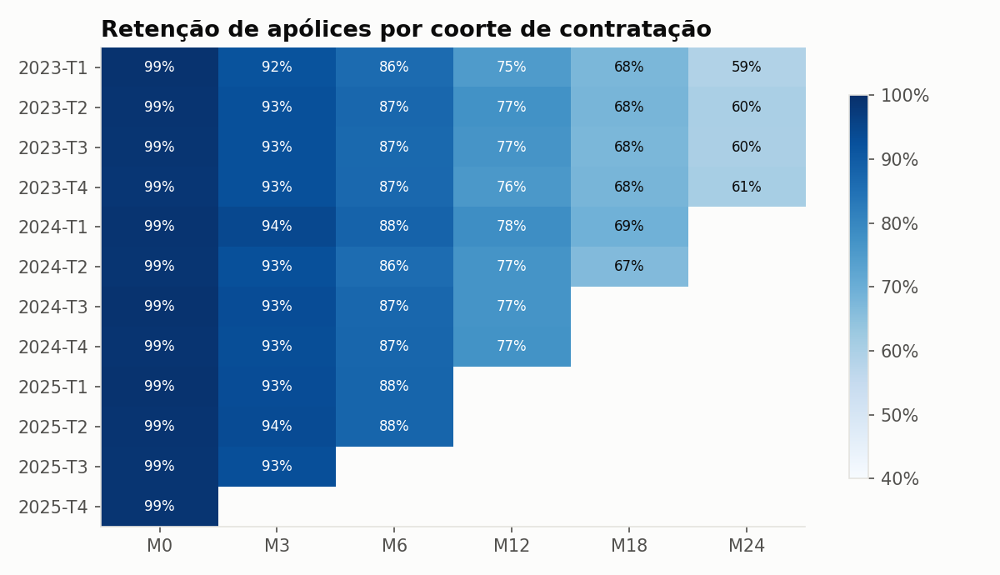
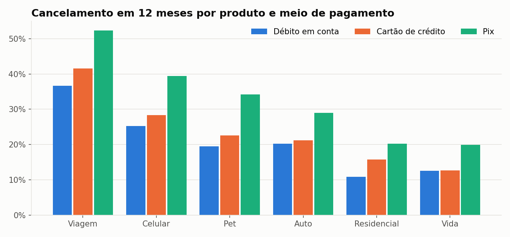
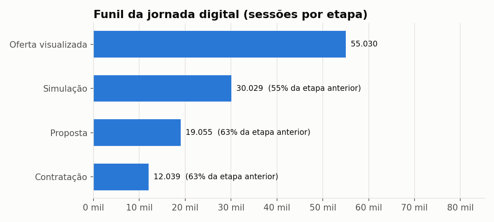
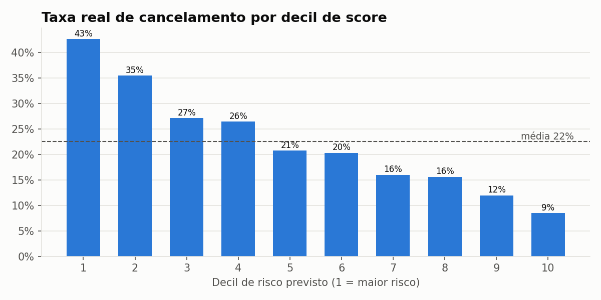

# Análise de dados e modelagem de uma carteira de seguros digital


Projeto de ponta a ponta que simula o dia a dia de um analista de dados em uma **seguradora digital** que vende
seguros (Vida, Residencial, Auto, Celular, Viagem e Pet) pelo app de um banco: extração com **SQL**, validação de
**qualidade de dados**, **modelagem dimensional** (star schema), construção de **indicadores**, **relatórios
automatizados** e um **modelo estatístico** de risco de cancelamento.

> Todos os dados são **sintéticos**, gerados com regras de negócio realistas e problemas de qualidade injetados de propósito.

---

## O que o projeto entrega

| Etapa | O que faz | Onde está |
|---|---|---|
| 1. Dados brutos | Gera clientes, apólices, sinistros e eventos da jornada digital (~360 mil linhas) | [`generate_data.py`](src/insurance_analytics/generate_data.py) |
| 2. Qualidade de dados | 15 regras declarativas (unicidade, completude, validade, consistência, integridade) | [`data_quality.py`](src/insurance_analytics/data_quality.py) · [relatório](reports/qualidade_dados.md) |
| 3. Modelagem de dados | ETL que trata, coloca em quarentena e carrega um **star schema** em SQLite | [`etl.py`](src/insurance_analytics/etl.py) · [`schema.sql`](src/insurance_analytics/sql/schema.sql) · [doc](docs/modelo_de_dados.md) |
| 4. Indicadores | 8 consultas SQL versionadas e parametrizadas (CTEs, window functions, coortes) | [`sql/kpis/`](src/insurance_analytics/sql/kpis) · [dicionário de métricas](docs/dicionario_de_metricas.md) |
| 5. Relatório automatizado | Excel formatado + relatório executivo HTML com achados gerados a partir dos números | [`report.py`](src/insurance_analytics/report.py) · [`reports/`](reports) |
| 6. Análise exploratória | Perguntas de negócio + testes estatísticos (qui-quadrado, Kruskal-Wallis) | [notebook](notebooks/01_analise_exploratoria.ipynb) |
| 7. Modelo preditivo | Propensão a cancelamento em 12 meses: regressão logística vs. gradient boosting, validação *out-of-time*, odds ratios | [`model.py`](src/insurance_analytics/model.py) |
| 8. Testes e CI | 21 testes (integridade referencial, regras de negócio, cálculo pro rata) rodando no GitHub Actions | [`tests/`](tests) |

## Arquitetura



## Principais resultados (ano de 2025)

| Indicador | Valor |
|---|---|
| Apólices ativas | 21.706 |
| Clientes ativos | 16.025 (1,36 produto por cliente) |
| Prêmio ganho | R$ 11,8 milhões |
| Sinistralidade | 58,0% |
| Ticket médio mensal | R$ 60,73 |

**Achados e recomendações**

- **Sinistralidade:** Pet (72%) e Auto (69%) estão acima da referência de 60%; Viagem (24%) e Residencial (29%) são os mais rentáveis. → revisar precificação/aceitação de Pet e Auto.
- **Cancelamento:** quem paga com **Pix cancela 30%** em 12 meses, contra **19% no débito em conta** — diferença estatisticamente significativa (qui-quadrado, p < 0,001). → incentivar débito automático na contratação e validar com teste A/B.
- **Funil digital:** o maior gargalo é *oferta → simulação* (55% de passagem). → testar simulação com menos campos / pré-preenchida com dados da conta.
- **Cross-sell:** 71% dos clientes ativos têm um único produto, e cada produto adicional **reduz** o risco de cancelamento (odds ratio 0,83).
- **Modelo:** os 10% de apólices com maior score cancelam **43%** (vs. 22% da média) — lift de 1,9x para priorizar ações de retenção.

<p align="center">
  
  
  
  
  
  
</p>

## Modelagem de dados

Star schema com 4 dimensões conformadas e 4 tabelas fato em granularidades diferentes:

- `fact_policy` — uma linha por apólice (ciclo de vida acumulado)
- `fact_policy_month` — **snapshot periódico** apólice × mês, com prêmio ganho *pro rata die* — base para séries temporais, coortes e sinistralidade
- `fact_claim` — uma linha por aviso de sinistro
- `fact_funnel_event` — uma linha por evento da jornada digital

Detalhes, diagrama ER e decisões de modelagem em [`docs/modelo_de_dados.md`](docs/modelo_de_dados.md).

## Modelo de cancelamento

| Modelo | AUC (teste) | Average precision | Brier |
|---|---|---|---|
| **Regressão logística** (escolhido) | **0,664** | 0,356 | 0,164 |
| Gradient boosting | 0,663 | 0,354 | 0,164 |

- **Sem vazamento:** a ABT ([`abt_cancelamento.sql`](src/insurance_analytics/sql/abt_cancelamento.sql)) usa apenas informações disponíveis no momento da contratação.
- **Validação fora do tempo:** treino com contratações até jun/2024, teste com jul–dez/2024 — simula o uso real.
- **Por que logística:** desempenho equivalente ao gradient boosting e coeficientes interpretáveis para o negócio ([odds ratios](reports/modelo_odds_ratios.csv)).
- O AUC moderado é esperado: cancelamento tem muito componente aleatório. O valor está na **ordenação** (lift), não na previsão individual.

## Como executar

```bash
git clone https://github.com/brunofrancco/data-analytics.git
cd data-analytics
python -m venv .venv && source .venv/bin/activate   # Windows: .venv\Scripts\activate
pip install -e ".[dev]"

python -m insurance_analytics.pipeline     # gera dados, valida, carrega o data mart, KPIs, modelo e relatórios (~20s)
pytest                                      # testes
jupyter notebook notebooks/                 # análise exploratória
```

Opções: `--customers 50000` (tamanho da base), `--seed 7`, `--skip-model`.

As consultas podem ser executadas direto no banco gerado (`data/warehouse.db`) com qualquer cliente SQL (DBeaver, sqlite3)
ou conectadas a uma ferramenta de BI (Power BI / Tableau via ODBC SQLite).

## Estrutura

```
├── src/insurance_analytics/
│   ├── generate_data.py      # dados sintéticos com regras de negócio
│   ├── data_quality.py       # catálogo de regras de qualidade
│   ├── etl.py                # limpeza, quarentena e carga do star schema
│   ├── kpis.py               # executor das consultas SQL
│   ├── model.py              # modelo de cancelamento
│   ├── charts.py / report.py # gráficos, Excel e HTML
│   ├── pipeline.py           # orquestração (CLI)
│   └── sql/                  # DDL, KPIs e ABT
├── notebooks/                # análise exploratória
├── docs/                     # modelo de dados e dicionário de métricas
├── reports/                  # saídas geradas (relatórios e figuras)
└── tests/
```

## Tecnologias

Python (pandas, NumPy, scikit-learn, statsmodels, SciPy, matplotlib) · SQL (SQLite: CTEs, window functions,
cláusula VALUES) · openpyxl · Jinja2 · pytest · GitHub Actions

---

Autor: **Bruno Silva** · [GitHub](https://github.com/brunofrancco)
