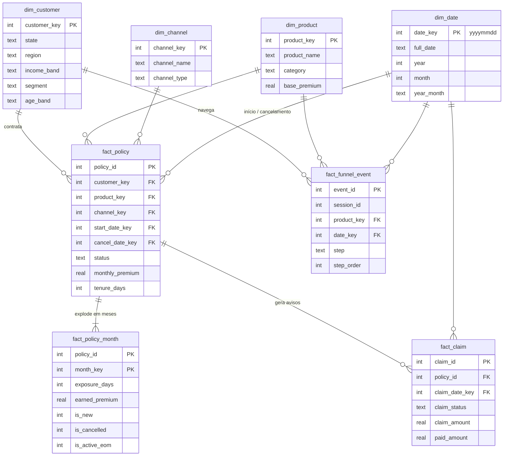

# Modelo de dados

O data mart segue a modelagem dimensional de Kimball: **dimensões conformadas** compartilhadas por várias tabelas
fato, cada uma com um **grão** bem definido. DDL completa em [`schema.sql`](../src/insurance_analytics/sql/schema.sql).

## Diagrama

## Tabelas fato

| Tabela | Grão | Tipo | Uso principal |
|---|---|---|---|
| `fact_policy` | 1 linha por apólice | acumulativa (ciclo de vida) | carteira ativa, churn em 12 meses, ABT do modelo |
| `fact_policy_month` | 1 linha por apólice × mês de vigência | snapshot periódico | prêmio ganho, séries mensais, coortes, exposição para frequência |
| `fact_claim` | 1 linha por aviso de sinistro | transacional | sinistralidade, frequência, severidade |
| `fact_funnel_event` | 1 linha por evento da jornada | transacional | funil de conversão |

## Decisões de modelagem

- **Snapshot mensal materializado.** Prêmio ganho e "apólices ativas no fim do mês" exigiriam expandir datas em toda
  consulta. Materializar `fact_policy_month` no ETL deixa os KPIs simples, rápidos e consistentes entre si.
- **Prêmio ganho *pro rata die*.** Apólice iniciada em 17/01 com prêmio de R$ 31 ganha R$ 15 em janeiro (15/31 dias).
  O mês do cancelamento sempre tem linha (mesmo com exposição zero) para que o evento seja contado.
- **Chave de data inteira `yyyymmdd`.** Legível, ordenável e eficiente para filtros por período (`BETWEEN 20250101 AND 20251231`).
- **Valor "ND" em vez de nulo** nas dimensões (UF, região, faixa etária), para que agrupamentos não percam linhas.
- **Quarentena em vez de descarte silencioso.** Linhas que violam regras bloqueantes são gravadas em
  `data/quarantine/` com o motivo, permitindo investigação com a área de origem.
- **Integridade testada.** `tests/test_warehouse.py` valida chaves estrangeiras, unicidade do grão e a consistência
  entre `fact_policy` e o snapshot (ex.: apólices ativas = ativas no fim do último mês).

## Regras de qualidade aplicadas no ETL

| Severidade | Tratamento | Exemplos |
|---|---|---|
| alerta | corrigido | `customer_id`/`policy_id` duplicado → deduplicação; UF minúscula/espaços → padronização; UF nula → `ND`; nascimento no futuro → nulo |
| bloqueante | quarentena | prêmio ≤ 0; cancelamento antes do início; cliente ou apólice órfã; sinistro antes da vigência; pago > avisado |

Resultado da última execução: [`reports/qualidade_dados.md`](../reports/qualidade_dados.md).
